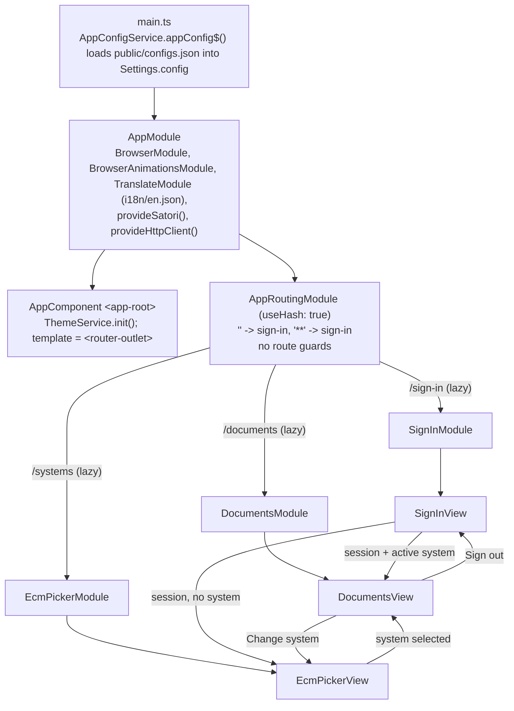
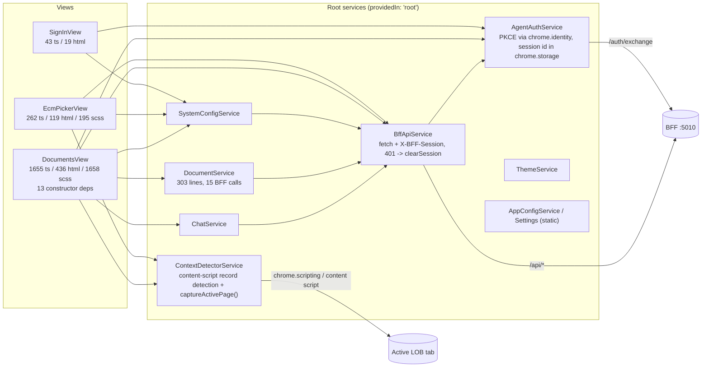
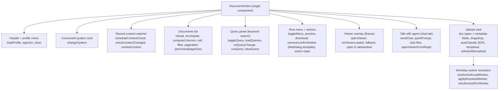
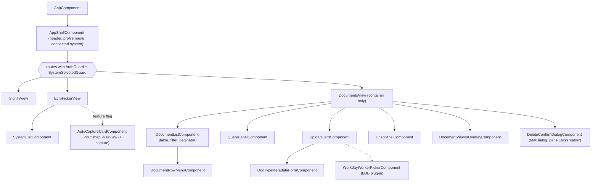
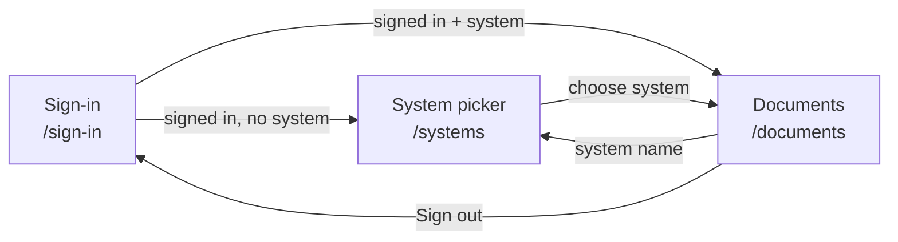
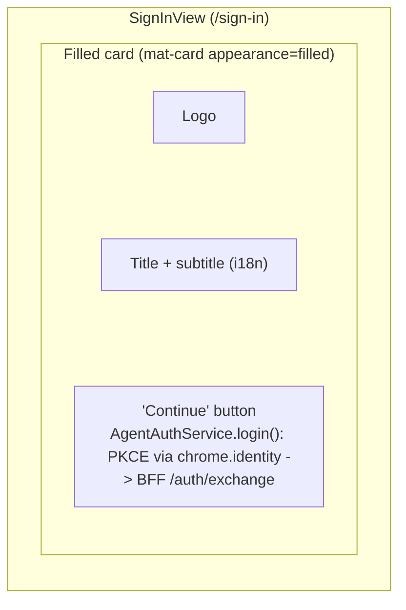
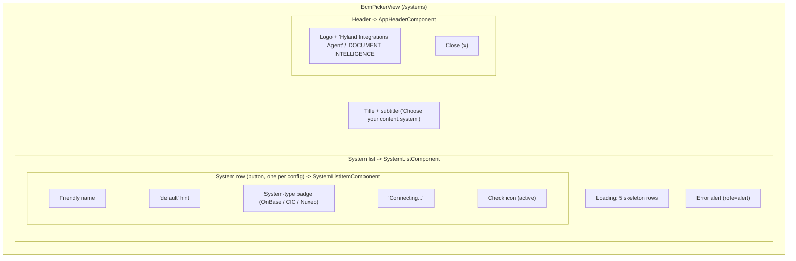
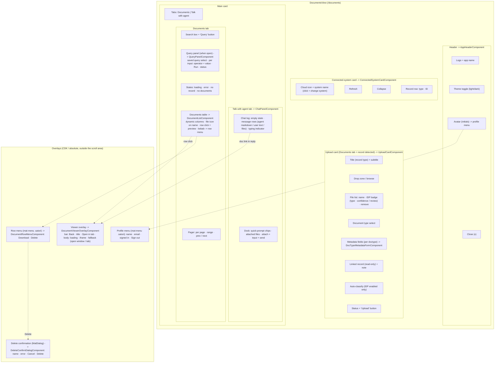

# Hyland Integrations Agent — Angular component diagram (agent-ng)

Generated from the code in `agent-ng/src` on 2026-11-24 (Angular 18, NgModule-based, hash routing, Chrome MV3
side panel; build output `browser-extension/ng`). Purpose: review the composition with the mentor, list the gaps,
and turn them into production work items.

## 1. Bootstrap and routing

Each view is the only component in its module: **there are no child components anywhere in the app.**

## 2. Components -> services -> BFF

BFF endpoints per caller:

| Caller | Endpoints |
|---|---|
| AgentAuthService | `POST /auth/exchange` |
| BffApiService | `GET /api/profile` |
| SystemConfigService | `GET /api/system-configs`, `POST /api/system-config` |
| DocumentService | `/api/context`, `/api/doctype-fields`, `/api/upload`, `/api/capture`, `/api/me`, `/api/worker/resolve`, `/api/idp/status`, `/api/idp/classify`, `/api/idp/extract`, `/api/viewer`, `/api/document/content`, `/api/document/delete`, `/api/query-metadata`, `/api/query-execute` |
| ChatService | `POST /api/chat` |
| EcmPickerView (direct, PoC) | `/api/context/extract`, `/api/autoconfig/agent-map`, `/api/capture/commit` |
| DocumentsView (direct, PoC) | `/api/context/extract` |

## 3. What is inside DocumentsView today (one component, eight features)

EcmPickerView likewise mixes the **system picker** with two **PoC cards** ("AI context" and "Auto-map" →
review → capture).

## 4. Gaps found in the code

| # | Gap | Evidence |
|---|---|---|
| G1 | God component | `DocumentsView`: 1655 ts + 436 html + 1658 scss, ~95 methods, 13 injected deps, 8 features, no child components |
| G2 | No unit tests | 0 `*.spec.ts` files |
| G3 | No route guards | Auth / selected-system checks done inside each view's `ngOnInit`; `''` and `**` both go to sign-in |
| G4 | HTTP outside Angular | `BffApiService` uses `fetch` (not `HttpClient`, although `provideHttpClient()` is registered) → no interceptors; hand-written `zone.run` + `cdr.detectChanges` everywhere |
| G5 | Weak typing | 46 `: any` usages; most BFF responses untyped |
| G6 | Satori: font icons | 21 `<mat-icon>`; 0 imports of `@hylandsoftware/satori-icons` |
| G7 | Satori: hardcoded styling | 12 hex colors in scss/html; 20 inline `style=` (mostly the PoC cards in `ecm-picker.view.html`) |
| G8 | Satori: loading states | 8 spinners / progress bars; guardrails require skeleton "ghost" layouts |
| G9 | i18n holes | PoC cards in `ecm-picker.view.html` have hardcoded English (~9 text nodes; e.g. "Generate mapping", "Upload") |
| G10 | LOB-specific logic in the generic view | Workday worker resolution / self-scoping lives inside `DocumentsView` |
| G11 | No shared state | Record context resolved separately by DocumentsView and EcmPickerView; PoC caches `aiContext` in the view |
| G12 | Mixed responsibilities in ContextDetectorService | Content-script record detection + page capture (`captureActivePage`) + tab-change events in one service |
| G13 | PoC features always on | "AI context" / "Auto-map" cards and the direct PoC endpoint calls are not behind a feature flag |
| G14 | Dev-only session behaviour reachable | `devKeepSession` moves the session id from `storage.session` to `storage.local` (config-driven) |
| G15 | Logging / error handling | 3 `console.*`; errors are plain strings per view; no global `ErrorHandler` |
| G16 | Accessibility not verified | No audit against WCAG 2.2 AA (focus return after dialog/viewer, aria on menus, RTL) |

## 5. Proposed target composition (for discussion)

Services: `BffApiService` on `HttpClient` + `AuthInterceptor`/`ErrorInterceptor`; typed API models; a
`RecordContextStore` (signals) shared by all views; `ContextDetectorService` split into
`ActiveTabCaptureService` + `RecordContextService`; Workday logic moved to a `WorkdayWorkerService`.

## 6. Draft work items (to refine together)

| ID | Work item | Acceptance criteria | Gap | Priority |
|---|---|---|---|---|
| W1 | Split `DocumentsView` into child components (list, row menu, query panel, upload card, metadata form, chat panel, viewer overlay, delete dialog) | Container < 300 lines; each child has typed `@Input`/`@Output`; no behaviour change | G1 | P1 |
| W2 | Unit-test baseline | Specs for services (auth, bff, document, system-config) + each new child component; tests run in CI | G2 | P1 |
| W3 | Route guards | `AuthGuard` (session) and `SystemSelectedGuard`; views no longer redirect themselves | G3 | P1 |
| W4 | Move BFF client to `HttpClient` + interceptors | Session header + 401 handling in an interceptor; no manual `zone.run`/`detectChanges` for HTTP | G4 | P1 |
| W5 | Typed API models | Interfaces for every BFF response used by the UI; `: any` removed from services | G5 | P2 |
| W6 | Satori icons | All `<mat-icon>` replaced by `@hylandsoftware/satori-icons`; `satori-lint no-material-font-icons` on | G6 | P1 |
| W7 | Satori tokens | No hex colors / inline `style=`; MD3 system variables; light + dark checked | G7 | P1 |
| W8 | Skeleton loading states | Ghost rows for the document list, ghost upload card; spinners removed | G8 | P2 |
| W9 | i18n completeness | Every user-facing string from `en.json`; lint/check that templates have no raw text | G9 | P1 |
| W10 | Extract Workday-specific logic | `WorkdayWorkerService` + optional component; generic view has no LOB `if`s | G10 | P2 |
| W11 | Shared record-context state | One `RecordContextStore`; all views read it; tab change updates it once | G11 | P2 |
| W12 | Split ContextDetectorService | Detection, page capture and tab events in separate services with tests | G12 | P3 |
| W13 | Feature flag for PoC features | `configs.json` flag hides AI context / Auto-map cards and their calls | G13 | P1 |
| W14 | Production session storage | `devKeepSession` disabled for production builds; session only in `storage.session` | G14 | P1 |
| W15 | Global error handling + logging | `ErrorHandler`, user-friendly messages from i18n, no `console.*` in prod | G15 | P2 |
| W16 | Accessibility pass | WCAG 2.2 AA: focus return (dialog, viewer), aria on menus/tables, keyboard-only run, RTL | G16 | P2 |

Open questions for the review:
1. Keep NgModules or move to standalone components while splitting (W1)?
2. Signals store vs RxJS service for `RecordContextStore` (W11)?
3. Do the PoC cards (zero-setup capture) graduate into the product, or stay behind the flag (W13)?

## 7. Core UI component diagram — as it looks on screen (PoC cards excluded)

Leaves out the two testing PoCs (the **AI context** card and the **Auto-map / solution mapper** card on the
system picker, plus their `/api/context/extract`, `/api/autoconfig/agent-map`, `/api/capture/commit` calls).
They stay in the code for now and will be removed later. Each box is a region of the real screen, top to bottom;
"→ X" is the child component it should become (section 5). Dashed boxes are conditional.

### 7.1 Screen flow

### 7.2 Sign-in — `SignInView`

### 7.3 System picker — `EcmPickerView` (core part only)

### 7.4 Documents — `DocumentsView`

### 7.5 Core UI tree (parent -> children)

| Parent | Children today (template regions) | Becomes |
|---|---|---|
| `AppComponent` | `<router-outlet>` | + `AppShellComponent` (shared header) |
| `SignInView` | card: logo, title, Continue | unchanged (small) |
| `EcmPickerView` | header, title, system list (skeleton / error / rows) | `AppHeaderComponent`, `SystemListComponent` > `SystemListItemComponent` |
| `DocumentsView` | header + profile menu, system card, main card (tabs), upload card, viewer overlay, row menu, delete dialog | `AppHeaderComponent`, `ConnectedSystemCardComponent`, `QueryPanelComponent`, `DocumentListComponent` > `DocumentRowMenuComponent`, `ChatPanelComponent`, `UploadCardComponent` > `DocTypeMetadataFormComponent` (+ `WorkdayWorkerPickerComponent`), `DocumentViewerOverlayComponent`, `DeleteConfirmDialogComponent` |

### 7.6 Core-UI-only findings (PoC excluded)

- The header (logo, app name, close) is duplicated in `EcmPickerView` and `DocumentsView` -> one `AppHeaderComponent`.
- Hardcoded English in core screens: app name/tag ("Hyland Integrations Agent", "DOCUMENT INTELLIGENCE"), tab labels
  ("Documents", "Talk with agent"), row tooltip ("Open in the Hyland viewer…"), IDP badge tooltips ("Low confidence —
  please review", "High confidence"), typing indicator aria-label ("Agent is thinking"). -> W9.
- Hardcoded colors: 10 hex fills in the chat empty-state SVG (`documents.view.html`) + `#1e8e4e` in
  `sign-in.view.scss` (the 12th match was the 📄 emoji entity) -> MD3 tokens or a Satori illustration (W7).
- Spinners in core screens: query panel, doctype select, metadata fields, auto-classify, upload button, viewer -> W8.
- Native `<select>` elements (query, operators, pager, doctype) instead of Satori/Material selects -> new item W17.
- Table is a hand-built `<table>` + custom pager, not the Satori table wrapper + `mat-paginator` (guardrail) -> new item W18.
- `DocumentsView` still has PoC code (`detectAiContext`, `/api/context/extract`) with no UI on this screen -> remove with the PoC.

| ID | Work item | Acceptance criteria | Priority |
|---|---|---|---|
| W17 | Replace native selects | Query, operator, pager and doctype selects use Satori/Material select with `panelClass: 'satori'` | P2 |
| W18 | Satori table + paginator | Documents list uses the Satori table wrapper, sort headers and `mat-paginator` (`selectConfig` panelClass `satori`) | P2 |
| W19 | Shared app header | One `AppHeaderComponent` used by picker and documents (logo, name, theme, profile, close) | P2 |

## 8. As-is vs to-be (mentor review, 2026-11-25)

Mentor: show the component name on every UI control plus the service dependencies (as-is), then define how the
app should be structured: smart/dumb components, reusable UI controls/directives (dropdown, typeahead), theming,
a11y, translations, a facade layer consumed through models, a provider layer per third-party tool (KE, IDP,
agents…), centrally evaluated feature flags. Once the LLD is agreed, derive the stories.

Images (PNG 2x + SVG): `yash-work/diagrams/as-is-components-services.*`, `yash-work/diagrams/to-be-architecture.*`
(sources `.mmd` next to them; PoC cards excluded).

### 8.1 As-is: UI control -> owning component -> services

| UI control (Angular / Satori control) | Owning component | Services · methods |
|---|---|---|
| Continue (matButton) | SignInView | AgentAuthService.login/getSession · SystemConfigService.restoreRemembered |
| Header + close (matIconButton) | EcmPickerView | BffApiService.getProfile |
| System list rows (native button, mat-icon, badge) | EcmPickerView | SystemConfigService.list/setActive |
| Header: theme toggle, avatar, close (matIconButton, matTooltip) | DocumentsView | ThemeService.toggle |
| Profile menu (mat-menu .satori) | DocumentsView | BffApiService.getProfile · AgentAuthService.clearSession |
| Connected-system card | DocumentsView | ContextDetectorService.getActiveContext/onChange · SystemConfigService |
| Search + table + pager (native input/table/select) | DocumentsView | DocumentService.listForContext · fetchMe (Workday) |
| Query panel (native select/input, mat-spinner) | DocumentsView | DocumentService.fetchQueries/fetchQueryMetadata/executeQuery |
| Row menu, delete dialog, toast (mat-menu, MatDialog, MatSnackBar) | DocumentsView | DocumentService.downloadDocument/deleteDocument |
| Viewer overlay (iframe, DomSanitizer) | DocumentsView | DocumentService.openInViewer |
| Talk with agent (native input, chips, markdown) | DocumentsView | ChatService.send · DocumentService.listForContext |
| Upload card (drop zone, native selects/inputs, mat-spinner) | DocumentsView | DocumentService.listDocTypes/fetchDocTypeFields/upload/capture/fetchIdpStatus/classifyWithIdp/extractWithIdp/resolveWorker |

All services: root singletons, Promise-based, call `BffApiService` (raw `fetch`) with untyped payloads; one
`DocumentService` covers UCEB documents, capture, IDP and Workday (15 endpoints).

### 8.2 To-be: layers and rules (LLD proposal)

| Layer | Contents | Rules |
|---|---|---|
| 1 Shell + routing | `AppComponent`, `AppShellComponent`, router | Guards: `authGuard`, `systemSelectedGuard`, `featureGuard` (`canMatch`) |
| 2 Smart pages | `SignInPage`, `SystemPickerPage`, `DocumentsPage`, `ChatPage`, `AutoCapturePage` (flag) | Only place that injects facades; holds view state (signals); maps models to child inputs |
| 3 Dumb components | `AppHeader`, `SystemList(Item)`, `ConnectedSystemCard`, `DocumentTable`, `DocumentRowMenu`, `QueryPanel`, `UploadCard`, `FileDropZone`, `DocTypeMetadataForm`, `ChatLog`, `ChatComposer`, `DocumentViewerOverlay`, `ConfirmDialog`, `WorkerPicker` (flag) | `@Input` models / `@Output` events only, `OnPush`, no service injection, no HTTP |
| 4 Shared UI kit | `hyl-dropdown` (Satori select), `hyl-typeahead` (autocomplete `.satori`), `hyl-skeleton`, `*hylFeature`, `hylFileDrop`, `hylFocusReturn`, Satori icons, translate pipe | Satori-themed, a11y built in (labels, aria, keyboard), reused by every dumb component |
| 5 Cross-cutting | `ThemeService` (MD3 tokens, light/dark, RTL), i18n (ngx-translate), a11y (WCAG 2.2 AA), `FeatureFlagService`, `ErrorHandler`/Logger/Notification, shared models | One implementation each, provided at root |
| 6 Facades | `AuthFacade`, `SystemFacade`, `RecordContextFacade` (store), `DocumentFacade`, `CaptureFacade`, `ClassificationFacade`, `AgentChatFacade` | Interfaces + `InjectionToken`s; methods take/return models (no `any`, no endpoint knowledge) |
| 7 Providers | `UcebBffProvider`, `IdpProvider`, `KeProvider`, `AgentBuilderProvider`, `OtherAgentProvider`, `ChromeTabContextProvider`, `WorkdayWorkerProvider`, `IamPkceAuthProvider` | One class per tool implementing a facade; bound in DI via factory that reads config/flags |
| 8 Infrastructure | `HttpClient` + interceptors (session, errors, retry), Chrome API adapter, runtime config | Only providers touch these |

Feature flags: `FeatureFlagService` evaluates every flag once from runtime config (later a remote source) and is
read by (a) `featureGuard` on routes, (b) `*hylFeature` in templates, (c) the provider factories (e.g.
`ClassificationFacade` -> `IdpProvider` or `KeProvider`). No component reads `configs.json` directly.

To-be mapping (page -> dumb children -> facades -> providers):

| Smart page | Dumb children | Facades | Providers |
|---|---|---|---|
| SignInPage | — | AuthFacade, SystemFacade | IamPkceAuthProvider, UcebBffProvider |
| SystemPickerPage | AppHeader, SystemList > SystemListItem | SystemFacade | UcebBffProvider |
| DocumentsPage | AppHeader, ConnectedSystemCard, DocumentTable > DocumentRowMenu, QueryPanel, UploadCard > FileDropZone + DocTypeMetadataForm (+ WorkerPicker), DocumentViewerOverlay, ConfirmDialog | RecordContextFacade, DocumentFacade, CaptureFacade, ClassificationFacade | ChromeTabContextProvider, UcebBffProvider, IdpProvider / KeProvider, WorkdayWorkerProvider |
| ChatPage | ChatLog, ChatComposer | AgentChatFacade, RecordContextFacade | AgentBuilderProvider / OtherAgentProvider |
| AutoCapturePage (flag) | UploadCard, DocTypeMetadataForm | CaptureFacade, ClassificationFacade | UcebBffProvider, KeProvider |

Decisions needed before stories: (1) NgModules vs standalone; (2) signals vs RxJS for facades/stores; (3) flag
source (configs.json only vs remote); (4) Satori table/paginator and select wrappers available in our package
versions; (5) whether chat becomes its own route (`ChatPage`) or stays a tab.
