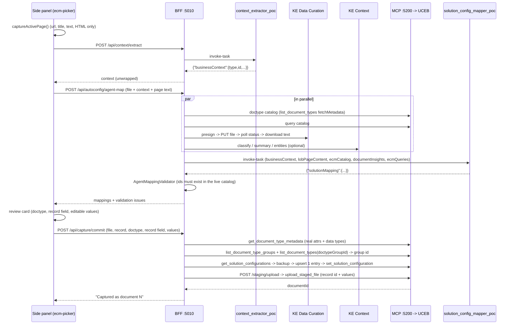

# Day 51 — 2026-11-19

## Zero-setup capture PoC — how it works end to end

**Goal:** the user opens a record in any LOB (Salesforce, ServiceNow, ...), opens the extension, drops a document,
and the agent picks the document type, fills the metadata and captures it into the ECM — **with no solution
config written by an admin beforehand**. Scope: capture only (no document list).

### The 3 running pieces

| Piece | Where | Runs at |
|---|---|---|
| Chrome extension (Angular side panel) | `agent-ng/` -> built into `browser-extension/ng/` | Chrome side panel |
| BFF (.NET 8) | `bff/` | `https://localhost:5010` |
| UCEB MCP server (.NET 8) | `Hyland.Experience.UCEB.McpServer/` | `http://localhost:5200` -> staging UCEB `api.uceb.app-intel.staging.app.hyland.com` |

### External services used

| Service | What it gives us | Auth |
|---|---|---|
| Agent Builder `context_extractor_poc` (`741a9eac-…`) | Which record is open: type + id (`businessContext`) | user's sign-in token |
| Agent Builder `solution_config_mapper_poc` (`028b4d65-…`) | The mapping: doctype, record field, field values | user's sign-in token |
| KE **Data Curation** API | Full document text (OCR for images) | client `DataCuration:ClientId/Secret` (user-secrets) |
| KE **Context** API (optional) | Classification + summary + entities | client `Ke:ClientId/Secret` (user-secrets) |
| UCEB (through the MCP server) | Doctype catalog, query catalog, solution config read/write, upload | MCP's UCEB login + `X-Api-Key` |

### Flow (what happens when you select Generate mapping, then Upload)



### Step by step, with the code

**1. Read the page** — `agent-ng/src/app/services/context-detector.service.ts` `captureActivePage()`
- One `chrome.scripting.executeScript` into the active tab (walks same-origin iframes, e.g. ServiceNow `gsft_main`).
- Returns `pageUrl`, `pageTitle`, `pageContent` (visible text, max 20k) and `pageHtml` (max 120k).
- `pageHtml` is HTML only (mentor's rule): body only; removes script/style/noscript/svg/canvas/link/meta/template/
  iframe, comments, `class`, `style`, `on*` handlers, base64/huge values; collapses whitespace. Keeps
  id/name/aria-*/data-*/role/href (used by the context agent's extraction recipe).

**2. Detect the record** — BFF `POST /api/context/extract` (`bff/Program.cs` ~line 518)
- Calls `context_extractor_poc` `invoke-task` with `{pageUrl, pageTitle, pageContent, pageHtml}`.
- `ExtractTaskOutcome` (~line 2314) unwraps `{"businessContext":{...}}` -> `{isBusinessObject, businessObjectType,
  businessObjectId, sourceSystem, confidence, evidence, basis, extractionRecipe}`.
- Panel keeps it in `aiContext` (reused, so the context agent runs once).

**3. Build the mapping** — BFF `POST /api/autoconfig/agent-map` (`bff/Program.cs` ~line 647)
Body `AgentMapRequest(Attachments, BusinessContext, PageContent)` (`bff/Models/BffModels.cs`). In parallel:
- `EcmDoctypeCatalog.FetchAsync` (`bff/Ke/EcmQueryCatalog.cs`) — all doctypes + attributes (id, name, dataType)
  of the ACTIVE system via MCP `list_document_types(fetchMetadata:true)`; parsed by `KeContextClient.ParseCatalog`.
- `EcmQueryCatalog.FetchAsync` (same file) — the ECM queries with inputs/operators/result columns.
- `DataCurationClient.ExtractAsync` (`bff/Ke/DataCurationClient.cs`) per file: token (client credentials) ->
  `POST /presign` (pii/chunking/embedding off, json_schema FULL) -> `PUT put_url` with `put_headers`
  (retries 5xx x3) -> poll `GET /status/{job_id}` until Done/Error/Deleted -> download `get_url` ->
  `markdown.output` -> `CleanMarkdown` (strips LOC comments, images, escapes).
- `KeContextClient.EnrichAsync` (`bff/Ke/KeAutoConfig.cs`) per file — optional; failure is only a warning.
Then:
- Builds `documentInsights` = `[{fileName, documentText, classification, summary, entities}]`.
- Invokes `solution_config_mapper_poc` with 5 String inputs: `businessContext`, `lobPageContent` (<=12k),
  `ecmCatalog`, `documentInsights`, `ecmQueries`. Prompt: `ke-poc/agent-test/mapper-instructions-v4.txt`.
  Studio settings: Claude Haiku 4.5, Task mode, temperature 0, **Max Tokens 8192** (was 4000 -> cut off).
- Saves the raw agent response to `bff/logs/agent-map/<utc>.json` (git-ignored).
- `ExtractNamedOutcome(body, "solutionMapping")` (~line 2291).
- `AgentMappingValidator.Validate` (`bff/Ke/AgentMappingValidator.cs`): parses the JSON-string fields, accepts
  object / string-encoded JSON / empty, checks every doctype id, attribute id, query id, query input and
  operator against the LIVE catalogs, normalizes `inputSource` to "1".."6". Problems go to `validation.issues`.
- Returns `{mappings, validation{valid, issues}, inputsSent}`.

**4. Review in the panel** — `agent-ng/src/app/views/ecm-picker/ecm-picker.view.ts` + `.html` (Auto-map card)
- `autoMap()` sends the files (base64), `businessContext`, page text.
- `toProposal()` builds `CaptureProposal`: record type + id (from the context agent), doctype id/name +
  confidence (`doctypeMapping`), record field (`recordLinkageMapping.boContext`), and one editable input per
  `fieldImportMappings` item prefilled with `sampleValue` (the value read from the document).
- "Mapping details" / "Capture details" = collapsible raw JSON.
- `ecm-picker.module.ts` imports `FormsModule` (for `[(ngModel)]` on the inputs).

**5. Capture** — `uploadMapped()` -> BFF `POST /api/capture/commit` (`bff/Program.cs` ~line 841)
Body `CaptureCommitRequest(Attachments, BusinessObjectType, BusinessObjectId, DocumentTypeId, RecordFieldId,
Fields[{Id, Value}])`.
1. MCP `get_document_type_metadata` -> real doctype name + attributes with data types. Unknown field ids are skipped.
2. `CaptureConfigWriter.CoerceValue` (`bff/Ke/CaptureConfigWriter.cs`): numeric types (Currency, Integer, ...)
   get only the number ("USD 2,322.00" -> "2322.00"); no number -> skipped + reported. Strings/dates unchanged.
3. `DoctypeGroupResolver.ResolveAsync` (same file): MCP `list_document_type_groups`, then
   `list_document_types(doctypeGroupId)` per group until the doctype is found; cached per system.
4. Solution config: MCP `get_solution_configurations` -> backup to `bff/config-backups/jit/<system>-<utc>.json`
   -> `CaptureConfigWriter.Upsert` replaces ONLY the (busObject, doctype) entry -> `set_solution_configuration`
   (must answer "saved").
5. Stage the file: `POST {mcp}/staging/upload` -> `stagingId`.
6. MCP `upload_staged_file` with `additionalAttributesJson = [{record field: record id}, ...reviewed values]`.
7. Returns `{documentId, system, documentType{id,name,groupId}, recordField, fields, skippedFields, configEntry,
   uploadResult}`; the panel shows "Captured as document N (...). Skipped: ...".

**The config entry written just in time** (`CaptureConfigWriter.BuildEntry`) — the validated minimum:
```
busObject, ecmContentTypeName, ecmContentTypeId,
ecmContentTypeGroupId   (required for OnBase/CFS, else "ArchiveDocument: An invalid operation occurred")
contextParams: []
ecmMetadataFieldLabels  (one per field)
displayColumns          (required, else 400 "The DisplayColumns field is required")
metadataFieldImportMappings:
  record field -> inputSource "1", value "Id"      (LOB record id)
  each field   -> inputSource "6", type = attribute dataType   (value supplied at upload)
```
Without any entry UCEB rejects the upload: 422 code 3422 "No matching business object configuration found".

### MCP server changes (`Hyland.Experience.UCEB.McpServer`)
- `Clients/UcebApiClient.cs` `GetDocumentTypesAsync(fetchMetadata, ct, doctypeGroupId)` — appends
  `&doctypeGroupId=` (non-Workday).
- `Tools/UcebTools.cs` `list_document_types` — new optional `doctypeGroupId` parameter.
- Tools used by the PoC: `list_document_types`, `list_document_type_groups`, `get_document_type_metadata`,
  `get_solution_configurations`, `set_solution_configuration`, `upload_staged_file`, (+ query tools for the
  catalog); HTTP `POST /staging/upload`.

### Configuration
- `bff/appsettings.json`: `ContextAgent`, `MappingAgent` (Agent Builder dev, `VersionId: latest`), `DataCuration`
  (token endpoint, scope `environment_authorization`, base URL, `JsonSchema FULL`, timeout 300), `Mcp`.
- BFF user-secrets (`uceb-bff-9f2c1a7e`): `DataCuration:ClientId/ClientSecret`, `Ke:ClientId/ClientSecret`,
  `Mcp:ApiKey`, auth client.
- MCP started with `bff/switch-lob.ps1 -Lob salesforce-staging`; active system `OnBase9714_Integrations_Agent`.
  MCP login must have `uceb.hfs_configuration.write` (config writes).

### Files — full list
| File | Role |
|---|---|
| `agent-ng/src/app/services/context-detector.service.ts` | Page capture (text + HTML only) |
| `agent-ng/src/app/views/ecm-picker/ecm-picker.view.ts` | `detectAiContext`, `autoMap`, `toProposal`, `uploadMapped` |
| `agent-ng/src/app/views/ecm-picker/ecm-picker.view.html` | AI context card + Auto-map card + review form |
| `agent-ng/src/app/views/ecm-picker/ecm-picker.module.ts` | `FormsModule` |
| `bff/Program.cs` | Endpoints `/api/context/extract`, `/api/datacuration/extract` (test), `/api/autoconfig/agent-map`, `/api/capture/commit`; `ExtractTaskOutcome`, `ExtractNamedOutcome` |
| `bff/Models/BffModels.cs` | `ContextExtractRequest`, `AgentMapRequest`, `CaptureCommitRequest`, `CaptureFieldValue` |
| `bff/Ke/DataCurationClient.cs` | Data Curation client + options |
| `bff/Ke/KeAutoConfig.cs` | KE Context client, `ParseCatalog`, catalog models |
| `bff/Ke/EcmQueryCatalog.cs` | `EcmDoctypeCatalog`, `EcmQueryCatalog` |
| `bff/Ke/AgentMappingValidator.cs` | Validates the agent mapping against the live catalogs |
| `bff/Ke/CaptureConfigWriter.cs` | JIT config entry (`Upsert`, `BuildEntry`, `CoerceValue`), `DoctypeGroupResolver` |
| `bff/appsettings.json` | Agent + Data Curation settings |
| `bff/logs/agent-map/` | Raw mapper responses (git-ignored) |
| `bff/config-backups/jit/` | Config backup before every JIT write |
| `bff/config-backups/onbase9714-salesforce-hfs-*.json` | Original + default (reset) config |
| `bff/jit-capture-test.ps1` | Same capture without the panel (used to isolate the Currency bug) |
| `ke-poc/` | `dc-run.ps1` (Data Curation test), `samples/invoice-scan.png`, `agent-test/` (mapper prompt v4 + fixtures) |
| `Hyland.Experience.UCEB.McpServer/Clients/UcebApiClient.cs`, `Tools/UcebTools.cs` | `doctypeGroupId` filter |
| `.gitignore` | `bff/logs/` |

### Problems hit on day 50 and their root causes (all fixed)
| Symptom | Root cause | Fix |
|---|---|---|
| `upload failed (502) Bad Gateway` | Data Curation storage gateway transient 5xx | PUT retries 5xx x3 |
| HTTP 500 after Generate mapping | Agent returned `recordLinkageMapping` as non-object; validator indexed it | `AsObject()` in validator |
| "No record was detected on this page" | Agent Builder wraps Task output `{"businessContext":{...}}`; BFF didn't unwrap | `ExtractTaskOutcome` unwraps |
| Upload 500 "unexpected error at the broker" | Currency keyword 234 got text "USD" (proved with runs A–D) | `CoerceValue` |
| 502 "max_tokens limit" | Mapper output ~10–12k chars > 4000 tokens | Studio Max Tokens 8192 |
| 504 "Failed to exchange token" | Agent Builder dev gateway timeout (30.6s) on the context agent; mapper worked with the same token | Retry; transient |

### Open / next
- Final end-to-end panel run (Generate mapping -> Upload) after the Max Tokens change: not confirmed yet.
- After the test: reset OnBase9714 Salesforce config to default (`config-backups/onbase9714-salesforce-hfs-reset.data.json`).
- Test docs in OnBase for account 001gK00001KbuonQAB: 417–422.
- Then ServiceNow (back up + reset hfsn config first; needs the OnBase doctypes/keywords — user step).

## Demo setup (2026-11-19)
- MCP started: `bff/switch-lob.ps1 -Lob salesforce-staging` (silent sign-in, app key `hfs`, :5200).
- Active system set: `OnBase9714_Integrations_Agent`. MCP token has `uceb.hfs_admin` + `uceb.hfs_configuration.write`.
- Config still had yesterday's test entry `account/Invoices` -> reset to default
  (`config-backups/onbase9714-salesforce-hfs-reset.data.json`); verified additionalConfig 0, queryConfig 0.
  So the demo starts from a truly empty config.
- BFF built (0 errors) and started (:5010). Extension build from day 50 is current (`browser-extension/ng`).

## Demo run 1: HTTP 500
- BFF log: the context agent call (`Program.cs` ~585, `http.SendAsync`) threw `HttpRequestException: The SSL
  connection could not be established` -> `Win32Exception 0x80090304: The Local Security Authority cannot be
  contacted`. Windows' TLS layer (Schannel/LSA) failed before any request reached Agent Builder. Only
  `OperationCanceledException` was caught -> unhandled -> HTTP 500.
- Checked right after: TLS to api.agents.ai.dev / auth.dev / knowledge-enrichment staging all OK -> transient.
- NOT the cause: `[auth-diag] AGENT SCOPES ... MISSING`. Same line on day 50 when both agents worked; the token's
  `scope` claim is a JSON array and the diagnostic splits it as a string, so it always says MISSING (cosmetic).
- Fix: `SendWithConnectRetryAsync` — retries once (after 2s) when the connection fails with no response; both agent
  invokes (context + mapper) use it, and a second failure returns 502 `agent_unreachable` with the reason instead
  of a 500. BFF rebuilt (0 errors) + restarted.

## Catalog check (2026-11-19)
- All-at-once `GET /api/core/document-types?fetchMetadata=true&systemFriendlyName=OnBase9714_Integrations_Agent`
  -> 408 after 20s ("Processed 4 groups"). Per group (`&doctypeGroupId=<id>`) works (~3s each).
- PoC already falls back (`EcmDoctypeCatalog`: list without metadata, then
  `GET /api/core/document-types/{id}/metadata` per doctype) — costs ~20s extra while the first call times out.
- Live catalog: 6 groups / 14 doctypes — 116 Vendor Documents (205 Invoices), 102 Vendors (119 Invoice),
  118 Network Documents (214 Installation Invoice), 117 Commercial Lending (206–212 COM - *),
  119 Patient Records New (216/217/218), 111 Schedule (152 SCH - Schedule A). All carry 223/224.

## Demo ready (2026-11-19, second check)
- MCP :5200 and BFF :5010 running; active system OnBase9714_Integrations_Agent; config additionalConfig 0 / queryConfig 0.

## ServiceNow: context agent returned the URL sys_id, user wants the DOM identifier
- Page: Change Request CHG0040019. Agent returned `businessObjectId: 5b3530a953bd031026b6237f00e5e649` (URL
  `sys_id`) and its basis explicitly rejected `CHG0040019` as "a display identifier" (URL IDENTIFIER rule).
- Evidence the DOM number is the right one: `servicenow-solution-config.json` links ServiceNow by
  `boContext.boProp = "number"` -> `hfsn_recordNumber` (owner `opened_by` -> `hfsn_recordOwner`).
  Salesforce links by the URL `Id` -> `hfs_sObject_Id`; an Account page shows only a name (no numbered id field).
- Fix = prompt change in Studio (`context_extractor_poc` Instructions live only in Studio). USER STEP: paste a
  "DISPLAYED IDENTIFIER RULE" above the URL IDENTIFIER rule: prefer a LABELLED identifier field of the focused
  record (Number, Case Number, Ticket, Employee ID, Key, ...) whose value looks like a code (CHG0040019, INC…,
  HXSF-893, 21021), never a name/title; recipe primary = dom extractor, URL id = fallback; URL id only when no
  labelled identifier is shown. Then reword the URL rule to "use the URL id when no displayed identifier exists".
- Test: ServiceNow CHG0040019 -> expect `CHG0040019`; Salesforce Health Systems -> still `001gK00001KbuonQAB`.
